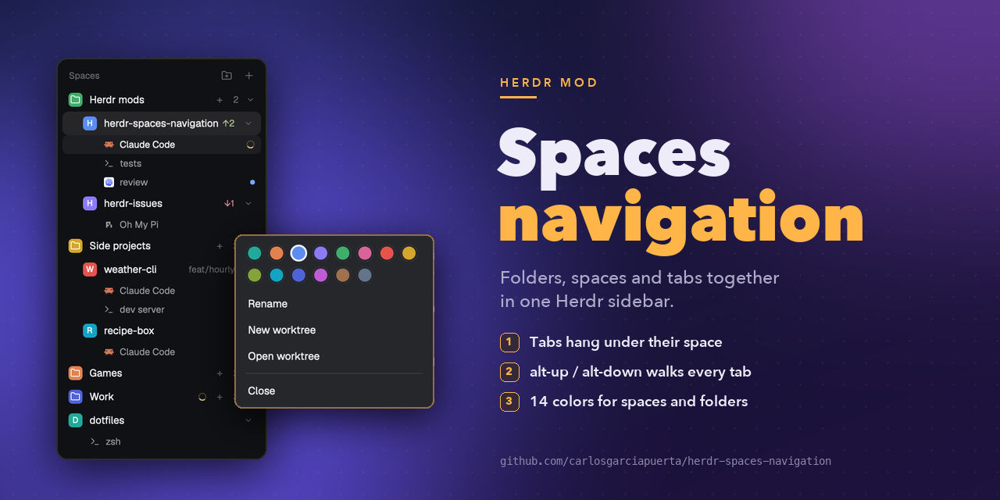
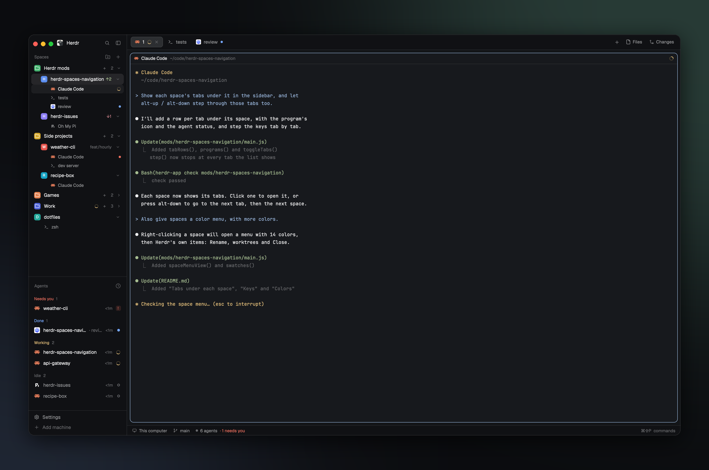
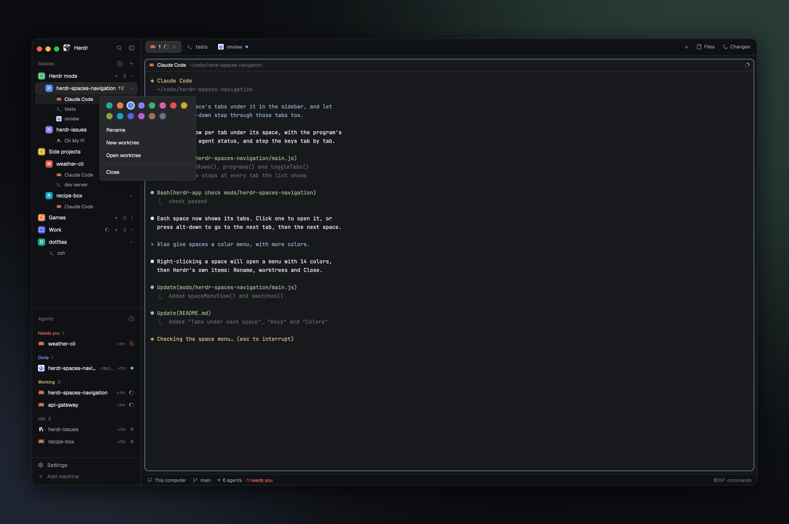

# Herdr Spaces Navigation



A spaces sidebar for the [Herdr](https://herdr.dev) desktop app. It shows folders, spaces and tabs in one list: each space's tabs hang under it, and the keys step through them in the order you see.

It is a fork of [jankeesvw/herdr-space-folders](https://github.com/jankeesvw/herdr-space-folders). Everything that mod does stays. This fork adds tab rows, tab navigation and more colors.



## What it adds to space-folders

| | space-folders | herdr-spaces-navigation |
|---|---|---|
| Tabs in the sidebar | no | one row per tab, under its space |
| `alt-up` / `alt-down` | space to space | tab to tab, then the next space or folder |
| Space color | no menu | 14 colors in the space's right-click menu |
| Folder colors | 7 | 15 |

## Tabs under each space

- **One row per tab**, indented under its space: the program's icon, the tab's name (an unnamed tab goes by its program, as in the tab bar), the agent's session name in grey after it (`Oh My Pi  TAB: Auto-name tabs`, taken from the title the agent gives its terminal), and its agent status: a spinner while working, a dot when done or blocked.
- **Session names** show by default. To hide or show them, right-click a space and pick "Hide session names" or "Show session names", or run `herdr-spaces-navigation.sessions` (`herdr-app do herdr-spaces-navigation.sessions`, or bind it in `keys.json`). The choice applies to every screen and stays after a restart.
- **Click** a tab row to show that space and that tab.
- **Double-click** a tab row to rename it.
- **Right-click** a tab row for Herdr's tab menu (rename, new tab, close).
- **The chevron on a space** folds its tabs away. This screen remembers it.
- In the narrow rail (sidebar under 160px), no tab rows show.

## Keys

`alt-down` and `alt-up` go to the next or previous tab in the list as it shows:

1. through the tabs of the space you are in,
2. then to the next space in the folder,
3. then to the next folder, then the spaces in no folder,
4. and from the end back to the top.

A space with folded tabs is one stop. Spaces in a folded folder are skipped.

## Colors



- **Right-click a space** to pick its color from 14. Below the colors are Herdr's own space items: Rename, New worktree, Open worktree, Remove worktree (in a worktree), Close.
- **Right-click a folder** to pick its color from 15 (grey and the same 14). Below the colors: New space here, Edit folder…, Delete folder.

## Folders (from space-folders)

- Colored folders that fold, filled by dragging or by rules on the folder a space works in (`wbso-ai`, `~/code/client-*`). The most specific rule wins.
- Drag a space onto a folder to file it, onto a space to put it there, or below the list to take it out. Drag folders to put them in order.
- A folder's **+** opens a new space in the folder's start folder.
- A folder can take in another machine, with its header and spaces.
- Folders are kept in `~/.config/herdr-space-folders.json` on the machine the spaces run on. This is the same file (and the same shared state) as space-folders, so both mods show the same folders.

See [RECIPE.md](RECIPE.md) for the full behavior.

## Install

The easy way: give your agent this repository's link (or https://herdr.dev/mods) and ask it to add the mod. It follows `~/.config/herdr-app/AGENTS.md`.

By hand: clone this repository and link the mod into Herdr's home.

```sh
git clone https://github.com/carlosgarciapuerta/herdr-spaces-navigation.git ~/code/herdr-spaces-navigation
ln -s ~/code/herdr-spaces-navigation/mods/herdr-spaces-navigation ~/.config/herdr-app/mods/herdr-spaces-navigation
```

Then put the mod in a layout's spaces block. Herdr's own layouts can't change their blocks, so make a copy of `main` first and change its copy:

```sh
herdr-app do layout.clone '{"name":"main","as":"main-navigation"}'
perl -pi -e 's/"mod": "spaces"/"mod": "herdr-spaces-navigation"/' ~/.config/herdr-app/layouts/main-navigation.json
```

`layout.clone` also shows the new layout. In a layout of your own, point its spaces block at the mod instead:

```json
{ "id": "spaces", "type": "block", "size": { "weight": 1 }, "min": 90, "content": { "mod": "herdr-spaces-navigation" } }
```

Last, add the keys. Copy the `layout:main-navigation` section of this repository's `keys.json` into `~/.config/herdr-app/keys.json`. For a layout with another name, rename the section to `layout:<name>`. Without it, `alt-up` and `alt-down` stay Herdr's own `space.prev` and `space.next`.

`ctrl-shift-l` switches back to your other layouts.

Herdr doesn't notice changes inside a symlinked mod folder. After a `git pull`, restart Herdr (or make the link again) to load the new version.

## Updates

Herdr doesn't update mods made by other people, and doesn't say when one has a new version. Each version of this mod is a git tag (`v1.1.0`) and a [GitHub release](https://github.com/carlosgarciapuerta/herdr-spaces-navigation/releases); [CHANGELOG.md](CHANGELOG.md) says what changed.

- **To hear of a new version**: on GitHub, Watch → Custom → Releases.
- **Installed with git and a symlink**: `git -C ~/code/herdr-spaces-navigation pull`, then restart Herdr.
- **Installed by an agent** (a copy, with no git): ask it to add the mod again from this repository.

## Keeping up with upstream

```sh
git remote add upstream https://github.com/jankeesvw/herdr-space-folders.git   # once
git fetch upstream && git merge upstream/main
```

Upstream's mod lives in `mods/space-folders/`; here it is `mods/herdr-spaces-navigation/`. Git follows the rename, so most merges apply by themselves. One exception: the folder rules (`rule`, `folderOf`, `lastPart`) moved from `main.js` to `logic.js` here, so an upstream change to them must be copied into `logic.js` by hand.

## Tests

```sh
pnpm test
```

This runs `node --test` (Node 20 or later; pnpm, as `packageManager` in `package.json` names it; no packages to install) on `test/`. The tests check `mods/herdr-spaces-navigation/logic.js`: the folder rules, which folder a space goes in, the stops `alt-up` / `alt-down` go to, and what a tab row is called (its name and the agent's session name). The drawing in `main.js` needs the Herdr app, so `herdr-app check` and a look in the app cover it.

## License

MIT (`LICENSE`), for herdr-space-folders by Jankees van Woezik and contributors and for this fork.

The mod started as a copy of the spaces mod that ships with [Herdr](https://herdr.dev). That code keeps Herdr's Apache License 2.0 (`LICENSE-APACHE`). `NOTICE` says where each part comes from and what changed.
