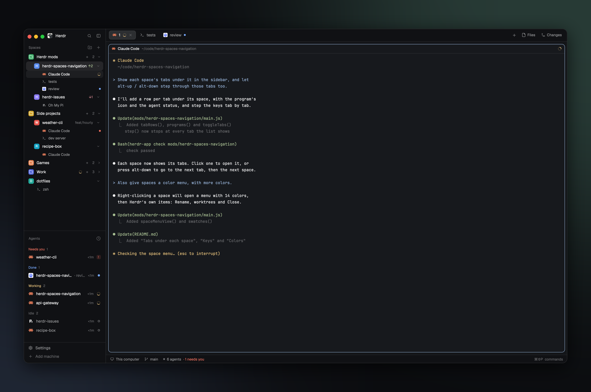

# Herdr Spaces Navigation

Herdr's spaces list with folders and tabs: colored, foldable folders above the loose spaces, filled by dragging or by rules on the folder a space works in, kept in a file in the home of the machine the spaces run on; each space's tabs hang under it, and the next/previous keys step through those tabs. Spaces and folders get their colors from their right-click menus. A fork of herdr-space-folders. It goes in a layout's spaces block.

## What you see

- **Colors**: six avatar colors, stored by name (`ansi6` `#22a99a`, `ansi3` `#e3814f`, `ansi4` `#5b8def`, `ansi5` `#8b7cf6`, `ansi2` `#3fae6a`, `ansi1` `#d9649a`), and eight more, stored as hex (`#e5534b`, `#d4a72c`, `#84a33a`, `#14a3c4`, `#4f63d8`, `#c05bd6`, `#a0714f`, `#64748b`). A space takes any of these 14; one with no color yet gets the avatar color the fewest spaces use (not the space at home, `~`). Kept in shared `space.colors` (space id → name or hex), as Herdr's own mods keep them. A folder takes any of the 14 or grey (`dim`, no color), kept in its `color` in the folders file.
- **The Spaces header**, 31px: "Spaces" in `dim` 11.5px, then a folder-plus button and Herdr's + (a new space), each 26px. The narrow rail shows only the +.
- **Per machine** (a header per machine once another one is known, as in Herdr's list; each header gets a folder-plus next to its +): the machine's folders in their order, each followed by its spaces when unfolded, then the spaces in no folder.
- **A folder's row**, 30px like a space's: an 18px tile with 5px corners in the folder's color (or `dim` grey) holding a white 13px folder icon, the name in `foreground` medium weight, then, when folded, a `working` spinner or a status glyph (● in `done` or `blocked`) for the most urgent agent in it, a `dim` "+", the count, and a chevron (down open, right folded).
- **A space's row**, 30px (28px for a worktree): an 18px tile in the space's color with its first letter in white (a worktree has a branch icon instead), the name, the git tail (repo and branch only when unusual, `↑ahead` in `ansi2`, `↓behind` in `ansi1`), and a chevron that folds its tabs (down open, right folded). The space in front is on `selected`.
- **Spaces in a folder** are indented to 26px; worktrees stay under their checkout.
- **A space's tabs**, under its row: 24px rows, 12px text, indented 27px more than the space (under its name). Each has its program's 13px icon (tinted `muted` when the program's icon takes a tint; `terminal` in `dim` when there's none), its name (a named tab by its name, an unnamed one by its program, else "Terminal"; " Z" when zoomed; at most 110px when a session name follows), then the agent's session name in `dim` 11.5px (the title its terminal shows, without leading spinners, emoji or Oh My Pi's "π"; none for a shell, a path, a user@host or the program's own name), then an 11px `working` spinner or a 6px `done` / `blocked` dot. The tab in front (the shown tab of the space in front) is `foreground` on `hover`; the others are `muted`, and `foreground` on `hover` under the pointer.
- **A machine in a folder** (a folder on this computer whose rules take it in): the machine's header, indented to 26px like the folder's spaces, then its folders and spaces at 26px. It no longer has a group of its own below, and once every other machine is in a folder the "This computer" header goes too. The folder's count and folded status include the machine's spaces.
- **The narrow rail** (sidebar under 160px): folders as their tile only, spaces as their number and a status glyph, no tab rows.
- **While dragging**: a space over a folder gives the folder an `accent` border on `selected`; a dragged folder goes half transparent and a 2px `accent` line shows where it lands; a space dragged out of a folder shows a dashed drop zone under the list, "Drop here to take it out of its folder".
- **A folder's menu** (right-click), a 236 by 190 popup: fifteen 20px color dots in rows of eight (grey, the six avatar colors, the eight more colors; the current one ringed in `foreground`, `muted` under the pointer), then "New space here", "Edit folder…", "Delete folder".
- **A space's menu** (right-click), a popup 236 wide: fourteen 20px color dots in rows of eight (the six avatar colors, the eight more colors; the current one ringed), then "Rename", "New worktree" and "Open worktree" when the space is in a repo, "Remove worktree" when it's a worktree, a line, "Hide session names" (or "Show session names" while they're hidden), "Close".
- **Edit folder**, a 460px dialog: Name; "Start new spaces in" with "Choose…" on this computer; "Collect spaces from" with a hint; Cancel and Save.

## How it behaves

- Click a space to show it (`space.select`). Click a folder to fold or unfold it. Press on a space and release on a folder to file it there; on another space, or on one of its tabs, to move it to that place (`space.move`) and into that space's folder; anywhere else in the list to take it out of its folder. Press on a folder and release on another to reorder: down puts it after, up before. Only within a machine.
- Click a tab row to show it (`tab.select {id}`, which shows its space too); double-click to rename it (`tab.rename`); right-click for Herdr's tab menu (`menu` with `{tab: "tab", target: {id, space}}`: Rename, New tab, Close).
- Click a space's chevron to fold or unfold its tabs (pressing it starts no drag). Kept per screen in the mod's `localStorage` (`tabs.folded`); folded machines likewise (`machines.folded`).
- "Hide session names" / "Show session names" in a space's menu, or the `herdr-spaces-navigation.sessions` command, hides or shows the session names on every tab row. Kept in shared `spaces-navigation.sessions` (false: hidden; shown otherwise), so every screen follows and it lasts past a restart.
- A dot in a space's menu sets that space's color in `space.colors`; a dot in a folder's menu sets the folder's `color` and saves the folders file. The menu closes.
- The space menu's worktree items open Herdr's `worktree` dialog (`{space, action: "new" | "open" | "remove"}`). Whether the space is in a repo or a worktree comes from the git the sidebar last read for it; before that read, the worktree items don't show.
- `alt-down` / `alt-up` (and `ctrl-shift-pagedown` / `pageup`, `ctrl-space shift-n` / `shift-p`) go one stop down or up the list as it draws: every tab row is a stop, and a space whose tabs don't show (folded, or the narrow rail) is one stop. The order: the tabs of each space in a folder, the machines that folder takes in, the next folder, the loose spaces, then the next machine; past the last stop it goes round to the first. A tab stop runs `tab.select {id}`, a space stop `space.select {id}`. Stops in a folded folder or machine are skipped. It starts from the tab in front (or its space's first stop); when that is folded away, it steps from where it would be.
- A space's folder: the one it was dragged into; "" (dragged out) keeps it out; otherwise the folder whose rules match deepest into the folder its first terminal works in (`~/code/client` beats `~/code`; on a tie the first folder wins). A worktree goes with its checkout's space.
- A machine goes in the first folder on this computer whose rules match its name or the folder one of its spaces works in; a rule like `vm-*` matches a name the way it matches a folder name.
- Rules, comma-separated, each take a folder and everything in it: starting with `/` or `~` they're paths (`~` any home: `/home/x`, `/Users/x`, `/root`), otherwise a folder name at any depth; `*` is any one folder name.
- A folder's + and "New space here" run `space.new` with the start folder (`~` made the machine's `$HOME`) and the machine; the first space that then appears on that machine within a minute goes in the folder (Herdr returns no id).
- Choosing a start folder while the rules are empty (or the same as it) sets the rules to it too.
- While a folder's name is still "New folder" (or empty, or the start folder's last part), it follows the start folder's last part, typed or chosen: `~/Projects/herdr/` names it `herdr`. Typing a name of its own stops that.
- Every folder change is shown at once (shared `space-folders`, per machine, `""` for this computer) and written to `~/.config/herdr-space-folders.json` on that machine (`exec sh` with `on`, through a temp file). Every 15 seconds each connected machine's file is read again; a file whose `at` is newer than what's shown wins.

## Built from

- **Mod** `mods/herdr-spaces-navigation/`: herdr-space-folders' `mods/space-folders/`, itself a `mod.clone` of Herdr's `spaces` (0.1.10), so its git, worktree, machine and drag-to-reorder code is Herdr's. `main.js` draws; `logic.js` holds what needs no app (`rule`, `folderOf`, `place`, `localId`, `lastPart`, `stopsOf`, `nextStop`, `leadsByTab`, `tabName`, `sessionName`). Folders: `grouped` (`foldered`, `folderHead`), the drop and reorder handlers, the folder menu (overlay props `folderMenu, machine`) and the edit dialog (overlay props `edit, machine, fresh`) as modes of the same mod. Tabs: `tabRows`, `toggleTabs`, and the drag helpers `aim` / `land` that space and tab rows share. Keys: `foldered` puts every space's `stopsOf` in `seen` as it draws; `step` asks `nextStop` and selects it. Colors: `MARK` and `MORE`, drawn by `swatches` in the folder menu and the space menu (`spaceMenuView`, overlay props `spaceMenu, git`), with `menuItem` for their items. The folders file and shared keys keep space-folders' names, so both mods show the same folders.
- **Tests** `test/logic.test.js`, run by `pnpm test` (`node --test`; `package.json` makes the `.js` files ES modules): `logic.js` only.
- **Where it goes**: a layout's spaces block, `{ "id": "spaces", "type": "block", "content": { "mod": "herdr-spaces-navigation" } }`. Herdr's own `main` has that block with `"mod": "spaces"`; shipped layouts can't change blocks, so `layout.clone {name: "main", as: "main-navigation"}` and change the copy.
- **Keys** `keys.json`: a `layout:main-navigation` section binding Herdr's next/previous space keys to `herdr-spaces-navigation.next` and `herdr-spaces-navigation.prev`; the mod's `nextCommand()` loop takes them.
- **herdr**: `spaces`, `panes`, `machines`, `run` (`space.new`, `space.move`, `space.select`, `space.rename`, `space.close`, `tab.select`, `tab.rename`), `openOverlay` (this mod's menus and dialog, Herdr's `menu` for tabs, Herdr's `worktree` dialog), `closeOverlay`, `props`, `shared` / `setShared` (`space-folders`, `space-folders.new`, `space.colors`), `exec` (with `on`), `hc` (`machine ls`), `watchFolder`, `layout`, `window`, `theme`, `pickFolder`, `home`, `nextCommand`.
- **Icons**: Herdr's own, from `mods/workspace-chrome/` (folder, folder-plus, plus, chevrons, spinner, terminal, branch, monitor, server), and the program icons `panes()` names (`icons/…`).

## Watch out

- There's no drag and drop between elements in mods: it's press on one, release on another, as Herdr's own tabs and spaces do.
- Herdr doesn't reload a mod from a symlinked folder when a file changes; recreating the link (or a restart) does.
- An overlay opened while its mod reloads can come up late or not at all.
- Space ids are per machine: remote spaces show as `machine/id` here and are stored by their own id in that machine's file.
- It runs programs, on the machine a space lives on: `git status` and `git rev-parse` in each space's folder (branch, ahead/behind, worktrees), `sh` to read and write `~/.config/herdr-space-folders.json` and to read `$HOME`, and `hc machine ls`. It watches each local repo's git folder (`watchFolder`) to read git again after a change. Other machines are reached only through Herdr's own connection to them.
- Herdr's right-click menu on a space can't be extended without cloning it, so this mod draws its own: the colors, then Herdr's items. It has no arrow keys, Enter, icons or key hints, as Herdr's has, and a new item in Herdr's own space menu won't show here until it's added. There's still no "Move to folder": drag instead.
- Herdr's own `space.next` and `space.prev` go by the order it keeps the spaces in, which folders don't change, so they jump around the list: the keys have to name the mod's commands instead. Those reach only a copy that shows, so with the sidebar hidden (`layout.toggle:sidebar`) they do nothing. The section is per layout: a layout of another name needs its own `layout:<name>` section.

## Done when

- `herdr-app check ~/.config/herdr-app/mods/herdr-spaces-navigation` passes, and so does `pnpm test`.
- Every space shows its tabs under it; clicking one shows that space and tab; the chevron folds them.
- Right-clicking a space shows 14 colors; picking one changes the space's tile. Right-clicking a folder shows 15; picking one changes the folder's tile.
- The folder-plus button opens Edit folder for a new folder, which is made only on Save; Cancel leaves nothing behind.
- Dragging a space onto a folder files it; dragging it out puts it back; dragging a folder reorders the folders.
- A folder with a start folder opens its new spaces there, in the folder.
- A rule such as `herdr-*` collects the spaces working in matching folders.
- `herdr-app do herdr-spaces-navigation.next` goes to a space's next tab; from the last tab of the last space in a folder it shows the first tab of the next folder's first space, and from the last stop in the list the first one.
- `~/.config/herdr-space-folders.json` changes with every folder edit, and another Herdr on the same machine shows the same folders.
